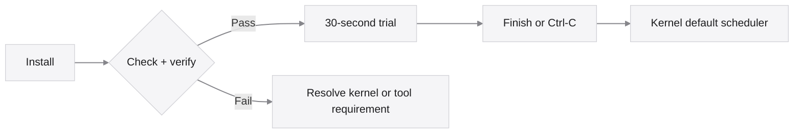

<h1 align="center">Lertick</h1>

<p align="center">CPU scheduling that learns inside the Linux kernel.</p>

<p align="center">
  <a href="#get-started-on-linux">Get started →</a> &nbsp;&nbsp;
  <a href="#how-it-works">Explore Lertick →</a> &nbsp;&nbsp;
  <a href="docs/INSTALL.md">Installation guide →</a>
</p>

<p align="center">
  
</p>

<p align="center">
  <strong>Learns task bursts.</strong> Training and inference run inside eBPF.<br />
  <strong>Adapts time slices.</strong> Predictions select bounded new CPU budgets.<br />
  <strong>Runs on your Linux.</strong> A finite foreground trial, with kernel fallback.
</p>

<p align="center">
  <a href="https://github.com/Denny-Lin/lertick/actions/workflows/docs.yml"></a>
  
</p>

<br />

## Get started on Linux

**A compatible running sched_ext kernel is required.** Loading and unloading Lertick on that kernel needs no reboot. Installing or booting a different kernel may require one; the helper never changes your kernel or boot configuration.

### 1. Check your running kernel

```sh
cat /sys/kernel/sched_ext/state
```

Continue when it reports `disabled`. If the file is missing, your running kernel is not ready for this installation path. If another scheduler is enabled, stop it through its own manager first. [Kernel requirements →](docs/INSTALL.md#1-check-the-running-kernel)

### 2. Build and install

On **Ubuntu 24.04**, install the build tools and matching kernel tools, then use your normal account to build:

```sh
sudo apt-get update
sudo apt-get install --no-install-recommends \
  git ca-certificates build-essential clang-18 llvm-18 pkg-config \
  libelf-dev zlib1g-dev libzstd-dev util-linux linux-tools-common "linux-tools-$(uname -r)"
git clone https://github.com/Denny-Lin/lertick.git
cd lertick
./deploy.sh install
```

The first build downloads pinned libbpf source and builds it locally. No distribution library is replaced. If `bpftool version` fails or your distribution packages it differently, use the [toolchain guide](docs/INSTALL.md#2-install-build-prerequisites).

### 3. Verify, then try 30 seconds

```sh
lertick check
lertick verify
lertick run --duration 30
```

`verify` asks the BPF verifier to load the programs **without attaching the scheduler**. Continue only after it succeeds. `run` activates online mode with all-task learning; it is an active scheduling trial. Press **Ctrl-C** to stop early. Normal expiry or loader termination releases its unpinned scheduler link.



`lertick plan` prints a command without loading or attaching anything. `lertick status` reports the current scheduler. After stopping, `lertick uninstall` removes the installed tools. Installation never starts a service or enables scheduling at boot. [Full usage and recovery →](docs/INSTALL.md)

## How it works


The model learns while tasks run, with no offline dataset, model download or cloud inference. After warm-up, predictions select newly assigned slice budgets within the default **0.5–5 ms** range. Those are assigned budgets, not a guarantee of exact execution time. Fairness accounting continues charging actual CPU service independently of predictions. [Architecture, modes and limits →](docs/OVERVIEW.md)

The helper learns from all eligible tasks by default. The raw loader's historical name-prefix default remains available for reproducible experiments. `shadow` trains while using fixed slices, and **still activates the scheduler**; it is not a passive preview.

## What has been tested

| Validation | Evidence |
| --- | --- |
| Runtime environment | **Ubuntu 24.04.5 LTS, ARM64, Linux 7.0.0-38-generic**, in a VM |
| Kernel integration | BPF verifier acceptance, registration, task execution, in-kernel model updates and bounded adaptive budgets |
| Historical correctness and recovery | 19 correctness cases, 15 recovery tests, churn and concurrent fork checks |
| Historical benchmarks | 360 completed scheduler/control trials with retained results and uncertainty |

Ubuntu release numbers alone do not determine support. Stock Ubuntu 22.04/24.04 GA kernels are not the tested sched_ext target; HWE/OEM kernels can differ. Other kernels require their own build, verifier and runtime checks. Physical-hardware performance remains unverified. [Exact requirements and deployment evidence →](docs/INSTALL.md)

**Learning works in the kernel. A scheduling advantage is not established.** Current comparisons found no reliable throughput gain over fixed slices, and some wake-latency cases regressed. Model variants and their unresolved outcomes remain documented. [Results and limitations →](docs/PHASE2_RESULTS.md) · [Model confirmation →](results/model-confirmation/README.md)

## Go further

| I want to… | Start here |
| --- | --- |
| Install, select a mode, log a trial or recover | [Native installation](docs/INSTALL.md) |
| Inspect the model, dispatch and CPU-frequency integration | [Implementation and modes](docs/OVERVIEW.md) · [Correctness](docs/PHASE2_CORRECTNESS.md) |
| Connect the optional Lerwatt power manager | [Lerwatt integration](docs/DEPLOYMENT.md#cpu-frequency-targets-and-the-lerwatt-plug-in) |
| Reproduce the VM results | [VM reproduction](docs/DEPLOYMENT.md) · [Benchmarks](benchmarks/README.md) |
| Contribute or report a problem | [Contributing](CONTRIBUTING.md) · [Issues](https://github.com/Denny-Lin/lertick/issues) · [Security](SECURITY.md) |

Lertick is **learning + tick**. Scheduler, loader and associated build material retain **GPL-2.0-only** notices; independently authored model, workloads and documents use **MIT**. [License boundaries and provenance →](THIRD_PARTY.md)
