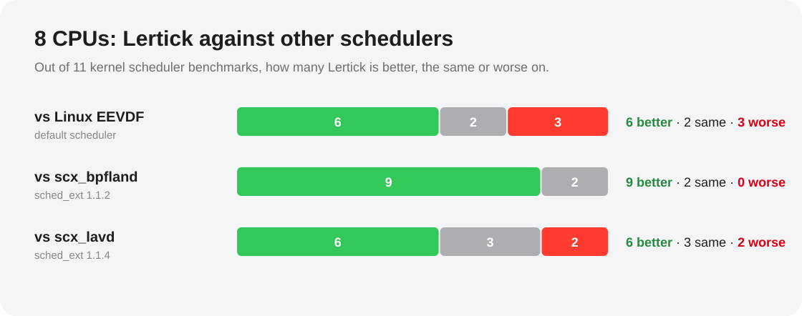
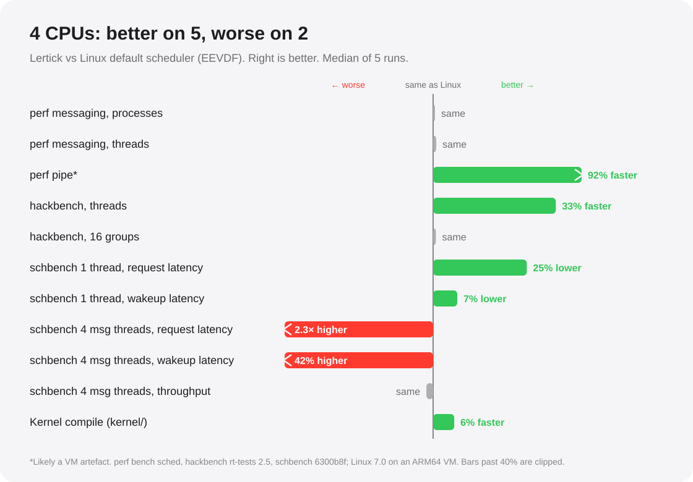

<h1 align="center">Lertick</h1>

<p align="center">A Linux CPU scheduler that learns inside the kernel.</p>

<p align="center">
  <a href="https://github.com/Denny-Lin/lertick/actions/workflows/docs.yml"></a>
</p>

## Performance

Lertick was tested on 11 common scheduler benchmarks in an ARM64 virtual machine (Linux 7.0) with 4 and 8 CPUs. Compared with Linux's default scheduler (EEVDF), it is faster on `perf bench pipe` and hackbench with threads, has lower schbench wakeup latency, and is 6 to 8% slower on `perf bench messaging` with processes. The rest are within 5% or better. It has not been tested on physical hardware yet.

<p align="center">
  
</p>

<p align="center">
  
</p>

<details>
<summary><strong>Each benchmark against Linux EEVDF</strong></summary>

<p align="center">
  
</p>

<p align="center">
  
</p>

</details>

<sub>Benchmarks: perf bench sched messaging and pipe, hackbench, schbench and a rebuild of kernel/sched. They were also used to choose between design variants. Lertick ran with its default settings. [How it was measured](results/deadline-ordering/README.md#how-results-are-measured) · [All runs](results/deadline-ordering/RECORD.md#deadline-order-2026-11-18)</sub>

## Get started

You need a Linux kernel with sched_ext: `cat /sys/kernel/sched_ext/state` should print `disabled`. Switching schedulers needs no reboot.

**1. Download**

```sh
git clone https://github.com/Denny-Lin/lertick.git
cd lertick
```

**2. Install** (Ubuntu 24.04)

```sh
sudo apt-get update
sudo apt-get install -y build-essential clang-18 llvm-18 pkg-config python3 \
  libelf-dev zlib1g-dev libzstd-dev linux-tools-common "linux-tools-$(uname -r)"
./deploy.sh install
```

**3. Turn on** (now and at every boot)

```sh
lertick enable
```

**4. Turn off** (Linux's default scheduler takes over immediately)

```sh
lertick disable
```

**5. Check status**

```sh
lertick status
```

**6. Everything else**

```sh
lertick help
```

**Remove**

```sh
lertick uninstall
```

If anything fails, Lertick stops and Linux's default scheduler keeps running.

[Documentation](docs/README.md) · [Other distributions](docs/INSTALL.md) · [Report a bug](https://github.com/Denny-Lin/lertick/issues/new?template=bug_report.yml) · License: GPL-2.0-only ([details](docs/legal/THIRD_PARTY.md))
