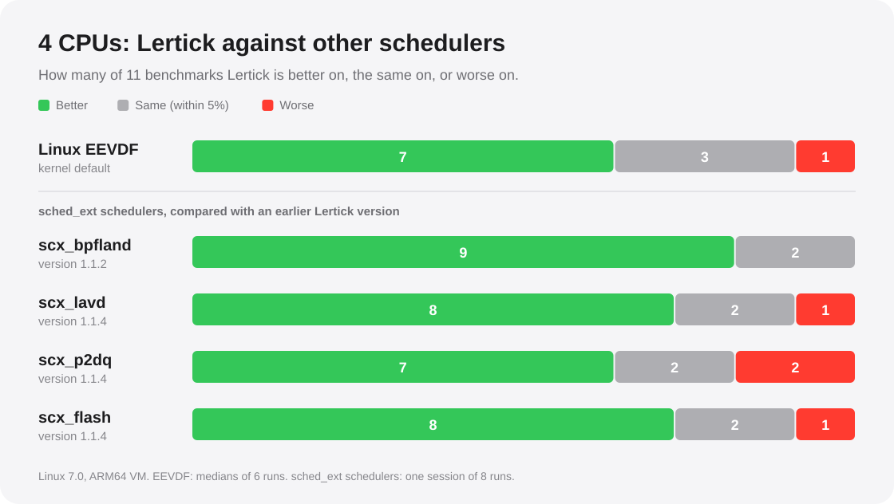

<h1 align="center">Lertick</h1>

<p align="center">A Linux CPU scheduler that learns inside the kernel.</p>

<p align="center">
  <a href="https://github.com/Denny-Lin/lertick/actions/workflows/docs.yml"></a>
</p>

## Performance

**Against Linux's default scheduler (EEVDF), Lertick is clearly faster on 4 to 6 of 11 standard kernel scheduler benchmarks, level on 2 to 7 and slower on 0 to 3.** The wins include `perf bench pipe`, hackbench threads and schbench wakeup latency; on 8 CPUs it is slower on none. The losses, all on 4 CPUs and 6 to 7% each, are `perf bench messaging` with processes and schbench latency when many message threads wake groups of workers. Against the community sched_ext schedulers it wins far more than it loses: scx_bpfland 8 to 2 and 7 to 0, scx_lavd 7 to 2 and 4 to 1, scx_p2dq 7 to 2 and 7 to 1, scx_flash 7 to 2 and 7 to 0 (4 and 8 CPUs).

<p align="center">
  
</p>

<p align="center">
  
</p>

<details>
<summary><strong>Each benchmark against Linux EEVDF</strong></summary>

<p align="center">
  
</p>

<p align="center">
  
</p>

</details>

<sub>Benchmarks: perf bench sched messaging and pipe, hackbench, schbench and a kernel compile, none of them used to choose Lertick's settings. Lertick runs in its default learned (`online`) mode on one ARM64 VM (Linux 7.0) using 4 or 8 CPUs; "same" means within 5%. Against EEVDF: the current version, median of 2 sessions (3 and 5 runs). Against the other schedulers: through EEVDF, comparing Lertick's ratio to EEVDF with each scheduler's ratio to EEVDF in its own two sessions, so treat those counts as indicative. The charts were measured before the three stability bounds added on 2026-11-17 (lag, wait and root-cgroup bounds); a rerun on a busy host showed no consistent change and an idle-host rerun is pending. Physical hardware is untested. [All runs →](results/deadline-ordering/README.md#readme-numbers-for-the-3-ms-slice-cap-2026-11-17)</sub>

## Get started

You need a Linux kernel with sched_ext: `cat /sys/kernel/sched_ext/state` should print `disabled`. Switching schedulers needs no reboot.

**1. Download**

```sh
git clone https://github.com/Denny-Lin/lertick.git
cd lertick
```

**2. Install** (Ubuntu 24.04)

```sh
sudo apt-get update
sudo apt-get install -y build-essential clang-18 llvm-18 pkg-config python3 \
  libelf-dev zlib1g-dev libzstd-dev linux-tools-common "linux-tools-$(uname -r)"
./deploy.sh install
```

**3. Turn on** (now and at every boot)

```sh
lertick enable
```

**4. Turn off** (Linux's default scheduler takes over immediately)

```sh
lertick disable
```

**5. Check status**

```sh
lertick status
```

**6. Everything else**

```sh
lertick help
```

**Remove**

```sh
lertick uninstall
```

If anything fails, Lertick stops and Linux's default scheduler keeps running.

[Documentation](docs/README.md) · [Other distributions](docs/INSTALL.md) · [Report a bug](https://github.com/Denny-Lin/lertick/issues/new?template=bug_report.yml) · License: GPL-2.0-only scheduler, MIT model and docs ([details](docs/legal/THIRD_PARTY.md))
