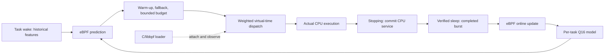

# Lertick — A Self-Learning CPU Scheduler for Linux

Lertick is an experimental Linux CPU scheduler that learns task CPU-burst duration online inside eBPF and uses sched_ext to select bounded time slices.

[](https://github.com/Denny-Lin/lertick/actions/workflows/docs.yml)
[繁體中文](README.zh-TW.md) · [Deployment](docs/DEPLOYMENT.md) · [Phase 2 results](docs/PHASE2_RESULTS.md) · [Benchmarks](benchmarks/README.md)

## Current status

**Phase 2A correctness and Phase 2B benchmarking are complete. This is a research prototype with validation on one ARM64 Linux VM.** Compilation, BPF verifier acceptance, sched_ext registration, real task execution, in-kernel updates, adaptive budgets and scheduler recovery passed.

| Validation | Recorded outcome |
| --- | --- |
| Environment | Ubuntu 24.04.5 ARM64, Linux `7.0.0-38-generic`, QEMU 10.2.1/HVF, 4 vCPUs, 4 GiB RAM |
| Correctness and lifecycle | 19 cases, 156 independent service checks, 4,200-task churn and 8,000 children from concurrent fork parents passed |
| Recovery | 15 tests covering SIGINT, SIGTERM, SIGKILL, SysRq-S and watchdog fallback passed |
| Benchmarks | 7 policies × 8 workload categories × 5 randomized repetitions, plus 80 overhead/control trials; all 360 trials passed |

**A useful learned scheduling advantage remains unproven.** All online/fixed throughput confidence intervals included zero change. Online wake p99 increased about **214% in mixed** and **147% in multicore** contention versus fixed slices. Linear prediction MAE exceeded same-episode EWMA in all six categories with eligible labels. These five-trial VM comparisons are exploratory; they do not establish superiority over Linux EEVDF or other sched_ext schedulers.

[Full results, uncertainty and overhead](docs/PHASE2_RESULTS.md) · [Raw evidence and analysis commands](results/phase2/README.md)

Phase 2C optimization is deferred. The next research priority is understanding how predictions affect responsiveness before tuning the model.

## Features and modes

- C/eBPF struct_ops scheduler derived from the pinned [official sched_ext C examples](THIRD_PARTY.md).
- Weighted virtual-time dispatch charges actual CPU service independently of predictions.
- CPU bursts accumulate across preemption and slice expiration; verified wake-to-sleep episodes provide labels. Attachment and exit are censored.
- Per-task five-feature Q16 linear model with bounded LMS updates. Features: bias, previous burst, burst EWMA, sleep interval and queue depth.
- Training and inference execute inside eBPF; the C/libbpf loader handles attachment and JSONL telemetry.
- Default prediction-selected budgets are 0.5–5 ms after eight valid labels, with a 2 ms fallback. Bounds apply to newly assigned budgets, not exact execution time or resumed remaining budgets.

| Mode | Learning or prediction | Newly assigned slice (defaults) |
| --- | --- | --- |
| `fixed` | Disabled | Fixed 2 ms |
| `shadow` | Linear training and inference inside eBPF | Fixed 2 ms |
| `ewma` | Historical burst EWMA; no linear training | Bounded EWMA after warm-up |
| `online` | Linear training and inference inside eBPF | Bounded model prediction after warm-up |

Model tracking defaults to tasks with a `lertick` name prefix. `--tracked-tgid PID` selects a process and `--track-all` enables learning for all tasks. Tracking controls model eligibility; it does not restrict which tasks sched_ext schedules. Partial switching is a separate `--partial` option.

## Architecture



Continuing-task decisions include committed and pending CPU service. Only `stopping` commits runtime and fairness charges. Live task/model storage is separate from the bounded LRU telemetry map. Predictions affect slice budgets; dispatch ordering and CPU selection remain based on the existing policy. See [correctness and kernel assumptions](docs/PHASE2_CORRECTNESS.md).

## Build and run

The scheduler requires a compatible Linux kernel with `CONFIG_SCHED_CLASS_EXT=y`, BPF syscall/JIT support and live BTF. Follow the [deployment guide](docs/DEPLOYMENT.md) to prepare the tested Ubuntu QEMU guest and pinned dependencies. Build against the running guest kernel. Containers share their host kernel and cannot replace this deployment validation.

Get the source:

```sh
git clone https://github.com/Denny-Lin/lertick.git
cd lertick
```

Inside the prepared Linux guest:

```sh
scripts/preflight.sh
scripts/build_libbpf.sh
export PKG_CONFIG_PATH="$PWD/build/deps/install/lib/pkgconfig${PKG_CONFIG_PATH:+:$PKG_CONFIG_PATH}"
make clean
make CLANG=clang-18
make test-model test-accounting
sudo build/scx_lertick --check
mkdir -p results/local
```

Start a finite scheduler in one guest terminal:

```sh
sudo build/scx_lertick --mode online --duration 30 --sample-ms 1000 \
  --stats-json results/local/scheduler.jsonl
```

While it runs, use another guest terminal to verify registration and exercise learning:

```sh
cat /sys/kernel/sched_ext/state     # enabled
cat /sys/kernel/sched_ext/root/ops  # scx_lertick
build/burst_workload --duration 8 --cpu 0 --burst-us 1000 --sleep-us 2000 \
  --phase-burst-us 6000 > results/local/workload.jsonl
```

Scheduler telemetry records labels, model coefficients, predictions and selected slices. Keep it with the workload's independently measured CPU service. See the [terminal example](examples/README.md) and [benchmark protocol](docs/PHASE2_BENCHMARKS.md) for further experiments.

Portable arithmetic and documentation checks also run on macOS:

```sh
make test-model test-accounting
python3 tests/check_docs.py
```

These checks do not establish verifier acceptance or Linux runtime compatibility. GitHub CI runs portable checks and compiles Linux workload fixtures; privileged scheduler validation runs separately in QEMU.

## Safety and recovery

Run privileged experiments in a disposable VM with an independent host control path. The loader defaults to 30 seconds, accepts 1–3600 seconds, and owns an unpinned struct_ops link. Normal expiry, SIGINT/SIGTERM and loader death detach it.

After shutdown, verify default scheduling is restored:

```sh
cat /sys/kernel/sched_ext/state  # disabled
```

From an independent guest administrator terminal, an emergency sched_ext abort is:

```sh
printf S | sudo tee /proc/sysrq-trigger >/dev/null
cat /sys/kernel/sched_ext/state
```

Use uppercase `S`. Deliberate watchdog tests require VM-only guards, partial switching and a selected target; use the [validation instructions](tests/README.md). Finite fairness and recovery tests do not prove universal starvation freedom or production safety.

## Documentation and scope

| Guide | Contents |
| --- | --- |
| [Deployment](docs/DEPLOYMENT.md) | QEMU setup, dependencies, build, load and recovery |
| [Phase 2 correctness](docs/PHASE2_CORRECTNESS.md) | Accounting, lifecycle, concurrency, fairness and proof limits |
| [Phase 2 results](docs/PHASE2_RESULTS.md) | Performance, prediction accuracy, overhead, regressions and uncertainty |
| [Benchmarks](benchmarks/README.md) | Workloads, randomized runs and reproducible analysis |
| [Phase 2 evidence](results/phase2/README.md) | Raw archives, manifests and integrity checks |
| [Phase 1 report](docs/PHASE1_RESULTS.md) and [original evidence](results/phase1/README.md) | Preserved historical validation under the ScxSprout name |
| [Rebranding validation](docs/REBRAND_VALIDATION.md) | Naming changes and separate regressions |
| [Contributing](CONTRIBUTING.md) and [security policy](SECURITY.md) | Contribution and reporting guidance |

Active scope is **Linux CPU scheduling**: burst prediction, in-kernel learning, adaptive slices, fairness, responsiveness and low scheduling overhead. Memory pressure is benchmark interference; memory allocation, reclaim, DAMON/DAMOS and NUMA memory placement are outside active development. Earlier research remains in the [background archive](docs/planning/README.md).

Cross-kernel compatibility, bare-metal performance, long-term production behavior, allocation-failure injection and PID-wrap reuse remain unvalidated. Results include sampling, censoring and observer-cost limitations. Original Phase 1 evidence is preserved byte-for-byte; detailed historical benchmark tables remain in its report.

## License

Original documents, the independent model and workloads use [MIT](LICENSE). The scheduler, loader, associated build material and vendored helpers retain their GPL notices. See [third-party provenance and license boundaries](THIRD_PARTY.md).
