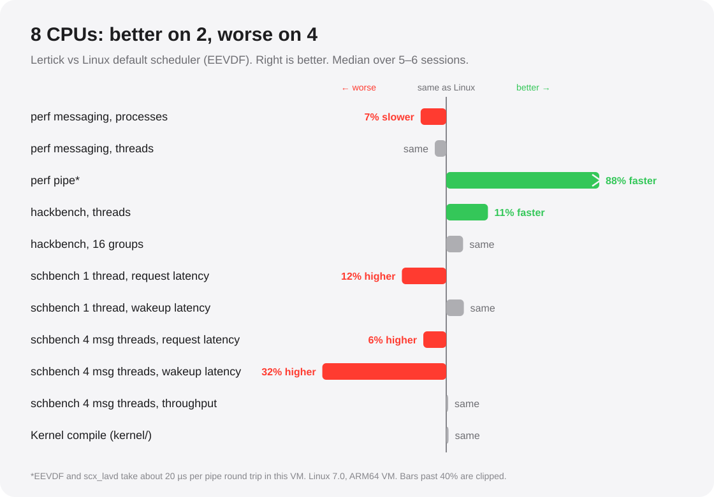

<h1 align="center">Lertick</h1>

<p align="center">A Linux CPU scheduler that learns inside the kernel.</p>

<p align="center">
  <a href="https://github.com/Denny-Lin/lertick/actions/workflows/docs.yml"></a>
</p>

## Performance

**Against Linux's default scheduler (EEVDF), Lertick is clearly faster on 8 of 11 standard kernel scheduler benchmarks on 4 CPUs and 4 on 8 CPUs, level on 2 and 6, and slower on 1.** The wins include `perf bench pipe`, hackbench and schbench wakeup latency, which it holds about 20% below EEVDF's. The loss is `perf bench messaging` with processes (6 to 8%). Run side by side with the community sched_ext schedulers, the previous build won far more than it lost: scx_bpfland 9 to 0 and 8 to 0, scx_lavd 8 to 1 and 4 to 1, scx_p2dq 7 to 2 and 5 to 0, scx_flash 8 to 1 and 8 to 0 (4 and 8 CPUs).

<p align="center">
  
</p>

<p align="center">
  
</p>

<details>
<summary><strong>Each benchmark against Linux EEVDF</strong></summary>

<p align="center">
  
</p>

<p align="center">
  
</p>

</details>

<sub>Benchmarks: perf bench sched messaging and pipe, hackbench, schbench and a kernel compile. They were first run as a held-out check; later rounds also used them to choose between variants. Lertick runs in its default learned (`online`) mode on one ARM64 VM (Linux 7.0) using 4 or 8 CPUs; "same" means within 5%. Against EEVDF: the current version (deadline order, 2026-11-18), median of 2 sessions of 8 runs each. Against the other schedulers: the previous build (without the deadline order), all six run in one session, shuffled, 8 runs; the deadline order mainly lowers Lertick's 4-CPU wakeup latency, so these counts are conservative. The kernel compile rebuilds kernel/sched. Physical hardware is untested. [All runs →](results/deadline-ordering/RECORD.md#deadline-order-2026-11-18)</sub>

## Get started

You need a Linux kernel with sched_ext: `cat /sys/kernel/sched_ext/state` should print `disabled`. Switching schedulers needs no reboot.

**1. Download**

```sh
git clone https://github.com/Denny-Lin/lertick.git
cd lertick
```

**2. Install** (Ubuntu 24.04)

```sh
sudo apt-get update
sudo apt-get install -y build-essential clang-18 llvm-18 pkg-config python3 \
  libelf-dev zlib1g-dev libzstd-dev linux-tools-common "linux-tools-$(uname -r)"
./deploy.sh install
```

**3. Turn on** (now and at every boot)

```sh
lertick enable
```

**4. Turn off** (Linux's default scheduler takes over immediately)

```sh
lertick disable
```

**5. Check status**

```sh
lertick status
```

**6. Everything else**

```sh
lertick help
```

**Remove**

```sh
lertick uninstall
```

If anything fails, Lertick stops and Linux's default scheduler keeps running.

[Documentation](docs/README.md) · [Other distributions](docs/INSTALL.md) · [Report a bug](https://github.com/Denny-Lin/lertick/issues/new?template=bug_report.yml) · License: GPL-2.0-only ([details](docs/legal/THIRD_PARTY.md))
