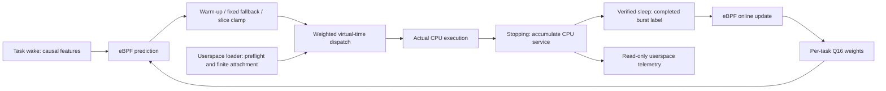

# Lertick — A Self-Learning CPU Scheduler for Linux

**Lertick is an experimental Linux CPU scheduler that learns task CPU-burst duration online inside eBPF and uses sched_ext to select bounded time slices.**

[繁體中文](README.zh-TW.md) · [Deployment](docs/DEPLOYMENT.md) · [Phase 1 results](docs/PHASE1_RESULTS.md) · [Naming research](docs/NAMING.md)

The project focuses exclusively on **online machine learning for Linux CPU
scheduling using sched_ext and eBPF**. CPU burst prediction, adaptive slices,
scheduling decisions, fairness, starvation prevention, low overhead, and
reproducible benchmarks define its scope. Learning and inference run in the
kernel; the loader observes telemetry and controls attachment lifetime.

**Status: Phase 1 works on the recorded Linux VM. This is an experimental
prototype, not a production scheduler.** Phase 2A passed Linux correctness and
safety checks, and Phase 2B completed 280 benchmark trials plus 80 observer/cost
trials. The linear model did not show a reliable throughput gain over fixed
budgets and regressed wake latency in two workloads. See
[Phase 2 results](docs/PHASE2_RESULTS.md). No general superiority over Linux
EEVDF or another sched_ext scheduler is established.

## Technical features

- C/eBPF struct_ops scheduler following the official C examples, pinned at
  `370b1cea95c6bb668d5b9261f069d433142b9986`.
- Shared weighted virtual-time dispatch; fairness charges actual CPU service
  from `sum_exec_runtime`, independently of predictions.
- CPU-burst labels accumulate across preemption and slice expiration. Only
  verified wake-to-sleep episodes train; attachment and exit are censored.
- Per-task five-feature Q16 linear model with clipped, bounded LMS updates.
  Features are bias, previous burst, burst EWMA, sleep interval, and queue depth.
- In-kernel training and inference, without a userspace trainer, neural network,
  or external inference service.
- Prediction-selected dispatch budgets bounded to 0.5–5 ms after eight labels;
  fixed fallback for invalid or exhausted predictions.
- Finite C/libbpf loader, kernel compatibility probes, JSONL task/model counters,
  controlled real CPU workloads, and independent arithmetic tests.

| Mode | Model | Newly assigned slice |
| --- | --- | --- |
| `fixed` | Disabled | Fixed 2 ms by default |
| `shadow` | In-eBPF training and inference | Fixed 2 ms by default |
| `online` | In-eBPF training and inference | Bounded predictions after warm-up |
| `ewma` | Historical burst EWMA; no linear training | Bounded EWMA after warm-up |

## Architecture



Continuing-task budgets deduct both committed and pending actual CPU service;
only `stopping` commits runtime and weighted fairness charges. A bounded LRU
telemetry map remains separate from live task/model storage.

The learned value affects time-slice budgets. Dispatch ordering, CPU selection,
and actual-service accounting follow the existing Phase 1 policy. The model
learns each tracked task separately. By default, workloads opt in with a
`lertick` task-name prefix; `--tracked-tgid PID` selects a particular process.

## Build and deploy

Portable checks on macOS or Linux:

```sh
git clone https://github.com/Denny-Lin/lertick.git
cd lertick
make test-model
make test-accounting
python3 tests/check_docs.py
```

The scheduler itself requires a compatible Linux kernel with
`CONFIG_SCHED_CLASS_EXT=y`, BPF syscall/JIT support, and live BTF. Build against
that running kernel, not a container's assumed kernel. The tested ARM64 QEMU
setup, pinned dependencies, and exact commands are in the [deployment guide](docs/DEPLOYMENT.md).

Inside the prepared Ubuntu guest:

```sh
scripts/preflight.sh
scripts/build_libbpf.sh
export PKG_CONFIG_PATH="$PWD/build/deps/install/lib/pkgconfig${PKG_CONFIG_PATH:+:$PKG_CONFIG_PATH}"
make clean
make CLANG=clang-18
make test-model
sudo build/scx_lertick --check
sudo build/scx_lertick --mode online --duration 10 \
  --sample-ms 250 --stats-json /tmp/lertick.jsonl
```

Use the [terminal experiment](examples/README.md) to run named workloads while
attached. Docker can supply build dependencies; it cannot replace QEMU's real
Linux kernel validation.

## Phase 1 validation and benchmark status

Original validation on 2026-10-09 used **Ubuntu 24.04.5 ARM64**, kernel
**7.0.0-38-generic**, **QEMU 10.2.1 with HVF hardware acceleration**, four vCPUs,
and 4 GiB RAM. Compilation, verifier acceptance, registration, actual execution,
online updates, adaptive budgets, and default-scheduler recovery passed.
Online mode recorded **1,345 updates and 1,355 adaptive execution segments**;
shadow recorded 1,348 updates; fixed recorded none.

Those measurements were made under the earlier ScxSprout name. All original
[Phase 1 evidence](results/phase1/README.md) is preserved byte-for-byte. The
separate [rebranding regression](docs/REBRAND_VALIDATION.md) checks the renamed
source and binary without changing the policy.

The original benchmark comprised three four-second repetitions per policy,
with a burst worker and two CPU competitors pinned to guest CPU 0. Values below
are medians of per-trial completion percentiles:

| Policy | p95 completion (ms) | p99 completion (ms) |
| --- | ---: | ---: |
| Default Linux | 3.259 | 3.350 |
| Official non-ML `scx_simple` | 20.016 | 20.128 |
| Lertick fixed policy | 2.015 | 2.031 |
| Lertick online policy | 2.023 | 3.996 |

**No ML performance improvement was demonstrated.** Online p99 was worse than
fixed and default in this short trial. Different slice defaults, warm-up,
logging, virtualization, and host scheduling limit interpretation. This is a
functional baseline, not evidence of superiority over EEVDF or other policies.
See [the full report](docs/PHASE1_RESULTS.md) for measurements and limitations.

## Phase 2 correctness and benchmarking

The [Linux correctness suite](tests/validate_phase2.py) passed 19 lifecycle cases,
156 independent CPU-clock/procfs service checks, 4,200-task churn, an additional
8,000-child concurrent fork/exec test under full preemption, three finite
fairness trials and three repetitions of all five recovery paths. A real
continuation witness changes the old slice decision after including pending
service. Eight equal competitors on four CPUs produced Jain indices above
0.99999 and observed progress gaps below 75 ms in the final full-preemption
regression. These are finite VM checks.

The [benchmark suite](benchmarks/README.md) compares default Linux, official
`scx_simple`, fixed, shadow, EWMA, online and compatible `scx_bpfland` across
eight categories. It retains randomized plans, raw data, kernel wake-to-switch
observations, uncertainty estimates, model errors and overhead measurements.
All 360 final trials passed. Online versus fixed kernel wake p99 increased
about 214% in mixed and 147% in multicore contention; all online/fixed throughput
intervals included zero change. Same-episode linear MAE exceeded EWMA in every
category with eligible labels. Optional timers reported instrumented arithmetic
means of roughly 24–26 ns per linear update and 14–15 ns per inference in two
workloads. The guest counter ticks about every 41.7 ns; those means average
quantized calls and include observer cost. They do not resolve individual
operations to that precision or establish uninstrumented overhead. A useful
learned scheduling advantage remains unproven.
See [the correctness report](docs/PHASE2_CORRECTNESS.md),
[protocol](docs/PHASE2_BENCHMARKS.md) and [results](docs/PHASE2_RESULTS.md).
Phase 2 commits remain local pending approval; no release or tag is created.

## Safety and recovery

Run privileged experiments in a disposable VM with an independent host control
path. The loader defaults to 30 seconds and accepts 1–3600 seconds. Its struct_ops
link is unpinned: normal expiry, SIGINT/SIGTERM, and process death close it.
The Linux suite also verified SIGKILL, SysRq abort, and a real stalled-task
watchdog fallback. No persistent service is installed.

Check state after shutdown:

```sh
cat /sys/kernel/sched_ext/state  # expected: disabled
```

From an independent guest admin console, an emergency sched_ext abort is:

```sh
printf S | sudo tee /proc/sysrq-trigger >/dev/null
cat /sys/kernel/sched_ext/state
```

Use uppercase `S`. Deliberate watchdog injection requires explicit VM-only
flags, partial switching, and one target TGID; reproduce it through the
[validation runner](docs/DEPLOYMENT.md), not on a production machine.

## Known limitations and scope

Only one ARM64 guest/kernel combination is validated. Cross-kernel support,
bare-metal results, long-term production behavior, allocation-failure injection,
PID-wrap reuse and universal starvation/fairness guarantees remain unvalidated.
Phase 2 fixes the known continuing-service issue and adds finite affinity,
churn and fairness tests. Slice bounds constrain newly assigned budgets, not
exact runtime or partially consumed budgets on resumed tasks. Diagnostic
timers, tracing and runtime accounting have observer cost.

Memory allocation optimization, reclaim, DAMON/DAMOS controllers, NUMA memory
placement, and joint CPU/memory management are outside the project. Useful
related findings remain in the [background research archive](docs/planning/README.md),
with no active or backup memory-development direction. CPU-topology metadata
and BPF map footprint remain relevant to scheduler validation.

Phase 2C optimization is deferred. The current evidence favors revisiting the
prediction-to-slice decision before tuning model parameters.
See [CONTRIBUTING](CONTRIBUTING.md), [security policy](SECURITY.md), and
[the decision record](docs/DECISIONS.md).

## License

Original documents, the independent model, and workload use [MIT](LICENSE).
The scheduler, loader, associated GPL build material, and vendored official
helpers retain their GPL notices. See [THIRD_PARTY](THIRD_PARTY.md) for exact
provenance and license boundaries.
