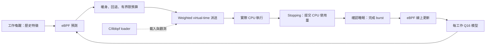

# Lertick — Linux 自我學習 CPU 排程器

Lertick 是實驗性的 Linux CPU 排程器，在 eBPF 內根據工作的歷史 CPU burst 線上學習，並透過 sched_ext 選擇有界限的時間片。

[](https://github.com/Denny-Lin/lertick/actions/workflows/docs.yml)
[English](README.md) · [部署指南](docs/DEPLOYMENT.md) · [Phase 2 結果](docs/PHASE2_RESULTS.md) · [基準測試](benchmarks/README.md)

## 目前狀態

**Phase 2A 正確性驗證與 Phase 2B 基準測試已完成。目前是研究原型，實際驗證涵蓋一個 ARM64 Linux VM。** 編譯、BPF verifier、sched_ext 註冊、真實工作執行、核心內更新、自適應時間片及排程器回復皆已通過。

| 驗證項目 | 實際結果 |
| --- | --- |
| 環境 | Ubuntu 24.04.5 ARM64、Linux `7.0.0-38-generic`、QEMU 10.2.1/HVF、4 vCPU、4 GiB RAM |
| 正確性與生命週期 | 19 個案例、156 個獨立使用量檢查、4,200-task churn，以及並行 fork 父程序建立的 8,000 個子工作皆通過 |
| 回復 | SIGINT、SIGTERM、SIGKILL、SysRq-S 與 watchdog fallback，共 15 個測試通過 |
| 基準測試 | 7 個策略 × 8 類工作負載 × 5 輪隨機順序，另加 80 個成本／觀測控制 trial；共 360 個 trial 全數通過 |

**尚未證明線上學習能提供有用的排程效能增益。** 所有 online/fixed 吞吐量信賴區間都包含零變化。相對 fixed 時間片，online 的喚醒 p99 在 mixed 與 multicore 競爭中分別增加約 **214%** 與 **147%**。六類有有效標籤的工作負載，線性模型的同 episode MAE 均高於 EWMA。每策略五次的 VM 比較屬探索性結果，不能據此宣稱普遍優於 Linux EEVDF 或其他 sched_ext 排程器。

[完整結果、不確定性與成本](docs/PHASE2_RESULTS.md) · [原始證據與分析指令](results/phase2/README.md)

Phase 2C 最佳化暫緩。下一個研究重點是先理解預測值如何影響回應延遲，再決定是否調整模型。

## 功能與模式

- 以 C/eBPF struct_ops 實作，源自固定版本的[官方 sched_ext C 範例](THIRD_PARTY.md)。
- weighted virtual-time 派送根據實際 CPU 使用量計費，與預測值分離。
- 跨搶占及時間片到期累積 CPU burst；經確認的喚醒至睡眠事件提供標籤，初始載入與退出事件排除。
- 每個工作使用五個特徵的 Q16 定點線性模型與有界限 LMS 更新：bias、上一個 burst、burst EWMA、睡眠間隔、佇列深度。
- 訓練與推論在 eBPF 內完成；C/libbpf loader 管理載入與 JSONL 遙測。
- 八個有效標籤後，依預測新派送的預設預算為 0.5–5 ms，固定回退值為 2 ms。界限適用新派送預算，不保證精確執行時間或恢復時的剩餘預算。

| 模式 | 學習或預測 | 新派送時間片（預設） |
| --- | --- | --- |
| `fixed` | 停用 | 固定 2 ms |
| `shadow` | eBPF 內線性模型訓練與推論 | 固定 2 ms |
| `ewma` | 歷史 burst EWMA；不訓練線性模型 | 暖身後依 EWMA 選擇有界限時間片 |
| `online` | eBPF 內線性模型訓練與推論 | 暖身後依模型預測選擇有界限時間片 |

模型預設追蹤名稱以 `lertick` 開頭的工作；`--tracked-tgid PID` 指定程序，`--track-all` 則對所有工作啟用學習。追蹤條件只決定模型資格，不限制 sched_ext 排程哪些工作。僅接管特定排程類別是另一個 `--partial` 選項。

## 架構



持續執行工作的決策納入已提交及尚未提交的 CPU 使用量；只有 `stopping` 提交執行量與公平性費用。真正的 task/model storage 與有界限的 LRU 遙測 map 分離。預測影響時間片預算；派送順序與 CPU 選擇仍遵循既有策略。參閱[正確性與核心假設](docs/PHASE2_CORRECTNESS.md)。

## 編譯與執行

排程器需要支援 `CONFIG_SCHED_CLASS_EXT=y`、BPF syscall/JIT 與 live BTF 的 Linux 核心。請依照[部署指南](docs/DEPLOYMENT.md)準備已驗證的 Ubuntu QEMU 客體與固定版本依賴，並根據運行中的客體核心編譯。容器共享主機核心，不能取代這項部署驗證。

取得原始碼：

```sh
git clone https://github.com/Denny-Lin/lertick.git
cd lertick
```

在準備好的 Linux 客體中：

```sh
scripts/preflight.sh
scripts/build_libbpf.sh
export PKG_CONFIG_PATH="$PWD/build/deps/install/lib/pkgconfig${PKG_CONFIG_PATH:+:$PKG_CONFIG_PATH}"
make clean
make CLANG=clang-18
make test-model test-accounting
sudo build/scx_lertick --check
mkdir -p results/local
```

在一個客體終端啟動有限時間排程器：

```sh
sudo build/scx_lertick --mode online --duration 30 --sample-ms 1000 \
  --stats-json results/local/scheduler.jsonl
```

運行期間，在另一個客體終端確認註冊並執行學習工作負載：

```sh
cat /sys/kernel/sched_ext/state     # enabled
cat /sys/kernel/sched_ext/root/ops  # scx_lertick
build/burst_workload --duration 8 --cpu 0 --burst-us 1000 --sleep-us 2000 \
  --phase-burst-us 6000 > results/local/workload.jsonl
```

排程器遙測記錄標籤、模型係數、預測及選定時間片；請與工作負載獨立測得的 CPU 使用量一併保留。其他實驗見[終端範例](examples/README.md)及[基準協定](docs/PHASE2_BENCHMARKS.md)。

macOS 也能執行可攜式算術與文件檢查：

```sh
make test-model test-accounting
python3 tests/check_docs.py
```

這些檢查不代表 BPF verifier 或 Linux 執行相容性。GitHub CI 執行可攜式檢查並編譯 Linux 工作負載；需特權的排程器驗證另在 QEMU 內執行。

## 安全與回復

請在可丟棄的 VM 內進行特權實驗，並保留獨立主機控制路徑。loader 預設運行 30 秒，可設定 1–3600 秒，擁有未 pin 的 struct_ops link。正常到期、SIGINT/SIGTERM 或 loader 死亡會卸載排程器。

結束後確認已回到預設排程器：

```sh
cat /sys/kernel/sched_ext/state  # disabled
```

從獨立的客體管理終端緊急中止 sched_ext：

```sh
printf S | sudo tee /proc/sysrq-trigger >/dev/null
cat /sys/kernel/sched_ext/state
```

必須使用大寫 `S`。故意觸發 watchdog 的測試需要 VM 防護、partial switching 與指定目標，請使用[驗證指南](tests/README.md)。有限公平性與回復測試不構成普遍無飢餓或生產安全保證。

## 文件與範圍

| 指南 | 內容 |
| --- | --- |
| [部署指南](docs/DEPLOYMENT.md) | QEMU、依賴、編譯、載入與回復 |
| [Phase 2 正確性](docs/PHASE2_CORRECTNESS.md) | 使用量、生命週期、並行、公平性與證明限制 |
| [Phase 2 結果](docs/PHASE2_RESULTS.md) | 效能、預測準確度、成本、退步與不確定性 |
| [基準測試](benchmarks/README.md) | 工作負載、隨機順序與可重現分析 |
| [Phase 2 證據](results/phase2/README.md) | 原始封存、manifest 與完整性檢查 |
| [Phase 1 報告](docs/PHASE1_RESULTS.md)與[原始證據](results/phase1/README.md) | 以舊名稱 ScxSprout 取得並完整保留的歷史驗證 |
| [重新命名驗證](docs/REBRAND_VALIDATION.md) | 名稱變更與獨立回歸測試 |
| [貢獻指南](CONTRIBUTING.md)與[安全政策](SECURITY.md) | 貢獻與問題回報方式 |

專案只開發 **Linux CPU 排程**：burst 預測、核心內學習、自適應時間片、公平性、回應延遲與低排程成本。記憶體壓力是基準測試干擾；記憶體配置、回收、DAMON/DAMOS 及 NUMA 記憶體放置不屬於目前開發範圍。較早的研究保留於[背景檔案](docs/planning/README.md)。

其他核心相容性、實體硬體效能、長期生產行為、配置失敗注入與 PID 回繞重用仍未驗證。測量包含取樣、截尾與觀測成本限制。原 Phase 1 證據逐位元保留，詳細歷史基準表仍在該階段報告內。

## 授權

原創文件、獨立模型及工作負載採 [MIT](LICENSE)。排程器、loader、相關建置材料與 vendored helpers 保留各自 GPL 聲明。詳見[第三方來源與授權邊界](THIRD_PARTY.md)。
