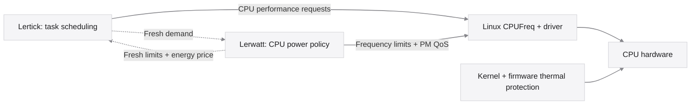

# Lertick + Lerwatt

[← Project home](../README.md) · [Lertick](https://github.com/Denny-Lin/lertick) · [Lerwatt](https://github.com/Denny-Lin/lerwatt)

Each controller works on its own and discovers an optional compatible local peer automatically. **Lertick owns scheduling; Lerwatt owns CPU power constraints.** They exchange demand and limits while keeping their models, training and service lifecycles separate.



## Automatic discovery

Install each project normally after satisfying its native Linux requirements.
Lerwatt needs CPUFreq controls, temperature inputs and Linux userspace BPF
headers. Lertick also needs a supported running sched_ext kernel, BTF and its
BPF toolchain. Neither installer changes the kernel or installs its peer.

From the Lerwatt checkout, as your normal user:

```sh
./deploy.sh check
./deploy.sh install
```

From the Lertick checkout, as your normal user:

```sh
./deploy.sh install
lertick enable
```

New Lerwatt installations save `contract=auto` and build the BPF-capable daemon;
new Lertick installations save `lerwatt=auto`. No `--lertick` installation flag
or `integration on` command is needed. Lertick installation still does not start
or enable scheduling: `enable` is the user's normal service activation, not a
peer-specific step. A plain upgrade preserves saved settings, including explicit
`off` opt-outs from earlier versions. For such a saved opt-out, choose auto once
with `./deploy.sh install --lertick` or `lertick integration auto` respectively.

**Either project may start first.** A service may be installed without running;
installation files alone do not prove a usable peer. Connection requires the
real maps plus matching ABI, topology, attachment session and fresh records.
Missing, stopped, removed, expired or incompatible peers leave local operation
independent. Running peers reconnect automatically; uninstalling a peer does not
stop the remaining controller. Neither service has `Requires=` or `BindsTo=` on
the other, and neither starts, stops, upgrades or retrains its peer.

Discovery is separate from prediction. Lerwatt keeps its own learned thermal
model and MPC, Lertick keeps its own scheduler model. Peer appearance/disappearance
never changes the selected prediction algorithm or private weights. New Lerwatt
installs use nominal MPC; cooperative prediction can be selected separately
with `--prediction cooperative` and retains all reliability gates. Earlier
saved cooperative choices are preserved. Installing Lertick does not make
Lerwatt forecasts more accurate.

Lertick's automatic mode is best effort: inability to discover topology, obtain
an attachment identity or publish maps leaves ordinary scheduling available.
It never overwrites foreign pins. Transport unavailable at initial attachment
requires a later local Lertick restart after the environment is repaired; this
is distinct from an absent peer, which connects later without restart. Raw
loader `--lerwatt` retains strict failure behavior for diagnostics. Raw loader
users can select `--lerwatt-auto`; normal helper/service runs do so automatically.

## Inspect or override discovery

```sh
lerwatt status
lerwatt logs
lertick integration status
lertick status
sudo systemctl show lerwatt.service lertick.service --property=StatusText
```

Configured `auto` means discovery is enabled; it does not mean connected.
Worker status/logs report **connected**, **waiting** or **off**. Waiting includes
an absent/inactive peer and rejected stale/incompatible records. Do not interpret
an older counter or an installed executable as current connectivity. Coordination
uses a 10–100 ms control period, with 100 ms the default.

Advanced explicit opt-outs remain available:

```sh
# From the Lerwatt checkout:
./deploy.sh install --no-lertick
# Only the Lertick managed service:
lertick integration off
```

These choices affect exchange, not either controller's learning. They do not
change Lerwatt's selected nominal/cooperative predictor. Lertick changes only
its own service when a managed integration setting is explicitly changed.
The strict legacy `lertick integration on` mode remains available. Configuration
is root-private strict data in `/etc/lerwatt/lerwatt.conf` and
`/etc/lertick/integration.conf`, never sourced as shell commands.

## Control ownership

| Decision or mechanism | Owner | Boundary |
| --- | --- | --- |
| CPU selection, dispatch, task slices and fairness accounting | Lertick | Kernel sched_ext still provides its registration and fallback mechanism. |
| Per-CPU performance requests | Lertick | Compatible schedutil/CPUFreq operation processes these requests; they are not measured frequency or a physical watt cap. |
| CPUFreq minimum/maximum constraints and available per-CPU PM QoS latency constraints | Lerwatt | Lerwatt keeps its own restore journal and controller lock. |
| Thermal-model fitting and predictive CPU ceiling policy | Lerwatt | Rule fallback and the raw-temperature guard remain independent of the scheduler link. |
| Frequency transitions, idle entry, driver sequencing and thermal trips | Linux drivers, kernel and firmware | Neither project replaces these protection or execution mechanisms. |
| Model weights, learning labels, checkpoints and model selection | Each project separately | No shared weights, joint optimizer or automatic joint retraining. |

Lerwatt currently uses only fresh `lat_crit_milli` from the demand record. The utilization, CPUperf and wake-latency fields support inspection and future policies; they do not establish an enforced application P99 target. Lertick can apply Lerwatt's limits and bounded energy-price adjustment to its performance requests. Task placement is not learned from this price.

These ownership rules describe the two projects. They do not arbitrate every privileged third-party writer. Lerwatt reports known competing power services before startup; another program can still change shared CPUFreq or PM QoS controls later. The contract is **advisory coordination, never a thermal safety interlock**.

## A stable protocol for independent updates

**An algorithm release is not a protocol revision.** A new predictor, thermal model or scheduling policy can retain the same contract and work with the existing peer. Model-only updates must not bump the ABI or require peer retraining. Each project validates, saves or refreshes its own learning state according to its own model format.

| Lertick ABI | Lerwatt ABI | Result |
| --- | --- | --- |
| 2 | 2, with matching topology and a fresh session | Optional coordination is eligible; fresh records are still required. |
| 1 | 2 | Handoff disabled; operate independently and report compatibility/waiting state. |
| 2 | 1 | Handoff disabled; operate independently. Upgrade the older peer to restore coordination. |
| Any | Missing, expired or incompatible peer | Operate independently. |

Update either project first. For a model-only release that keeps ABI 2, verify the new version's own readiness and the link's current status; the peer need not be updated or retrained. If a deliberate schema or field-meaning change introduces a new ABI, document the migration and compatibility matrix, expect independent operation during a mixed-version window, then update the other peer and recheck the link. Never label an incompatible pair connected.

Maintainers must preserve the shared header and golden binary-layout/topology-hash checks for compatible updates. Changing field layout, units or meaning requires an explicit ABI revision and migration tests. Model improvements still need workload and closed-loop evaluation; successful communication does not prove better scheduling or energy use.

## Contract ABI 2

Lertick owns two `BPF_MAP_TYPE_ARRAY` maps with `BPF_F_MMAPABLE`, pinned under `/sys/fs/bpf/lertick/` while its integration-enabled attachment runs. The directory is private. The link uses at most **eight CPUFreq policies**, sorted by their first CPU; larger systems remain independently controlled instead of silently mapping extra policies.

| Record | Single writer | Reader | Fixed size |
| --- | --- | --- | --- |
| `lw_contract` | Lerwatt | Lertick's BPF callbacks | 48 bytes |
| `lt_demand` | Lertick's userspace loader | Lerwatt | 64 bytes |

Both record types carry `version=2`, a sequence counter, `topology_id` and `session_id`. Capacity values use **0–1024**, where 1024 is the fastest CPU performance scale. A zero `ceiling_cap` means no contract cap. Energy price and latency-critical share use **0–1000**. Temperatures/headroom use millidegrees Celsius; timestamps are nanoseconds on **`CLOCK_MONOTONIC`**, not wall-clock time.

`topology_id` hashes the full sorted `related_cpus` set for the policy, followed by the CPU count. ABI 2 specifies FNV-1a with its `LWTOP2` domain and four little-endian bytes per CPU/count. It includes the full policy set, including simulated CPUs not present in a guest. This detects topology disagreement; it is not authentication. Lertick creates a fresh nonzero random `session_id` for each attachment. Lerwatt echoes that generation only after a compatible fresh demand record, so a previous attachment's limits do not authorize a new one.

| Timing rule | Value |
| --- | --- |
| Lertick demand publication target | Every 100 ms |
| Maximum accepted demand age | 500 ms |
| Lerwatt constraint lifetime | 300 ms |
| Retry interval when maps are absent | 1 second |
| Silent attachment age before dropping old maps | 2 seconds |

These are monotonic freshness limits, not realtime scheduling guarantees. The service loop requires 10–100 ms when coordination is enabled so its normal cadence fits the constraint lifetime. Missing, stale, malformed, differently identified or incompatible records provide no handoff. Lerwatt keeps its own local CPU control; Lertick keeps its own scheduler policy when no valid contract applies.

A writer marks the sequence odd during publication and even afterward. Readers use bounded consistency checks and can skip an update; the BPF path does not spin waiting for userspace. Records remain advisory, with field validation and bounded effects. This is not an atomic transaction across policies, a globally synchronized snapshot or proof of closed-loop stability.

## Failure and validation boundaries

Lertick exit/fallback removes its attachment and owned pins; Lerwatt can drop stale maps and retry a later attachment. Lerwatt failure invokes its own watchdog/restore/restart path; its contract limits expire independently. Lertick's `Restart=no` fallback policy is unchanged. Neither project's failure triggers a restart of the peer. Contract expiry does not undo Lerwatt's persistent sysfs settings; Lerwatt's journal recovery handles those separately.

Kernel thermal mitigation and hardware protection remain enabled throughout. Independent fallback means the link stops influencing the peer; it does not promise a fail-closed thermal cap. Supported CPU/sensor layouts, kernel compatibility, other writers and application performance still need their own validation.

Continuous 24-hour and seven-day physical-hardware reliability, physical energy savings and performance advantages are not established by this guide. Record exact software versions, hardware/kernel, duration, fresh-link observations and failure/recovery outcomes when contributing integration evidence.

## Keep independent updates compatible

Both repositories run a frozen **56-value ABI 2 guard** as part of `make test-deployment`. It compiles the public header alone and checks every field offset, record size, timing/scale constants, topology vectors and constraint-validation boundaries. It does not import a model or compare application release versions. A model-only change must preserve these values and the documented control ownership. Its inference/training work must also fit the publication cadence; expired advice always becomes absent advice.

Run the guard by itself, or compare two candidate checkouts before deployment:

```sh
make test-integration-abi
python3 tests/check_integration_abi.py --peer /path/to/other/repository
```

The [recorded ABI 2 validation](../results/integration-abi2/README.md) includes real sched_ext/BPF and systemd tests on Ubuntu 24.04.5 ARM64, kernel 7.0.0-38-generic. Changing Lertick's policy kept Lerwatt's process running; changing Lerwatt's point predictor kept Lertick's process/session running. Both re-established the same interface. These checks demonstrate method-selection compatibility and lifecycle behavior, not a prediction or performance improvement.
