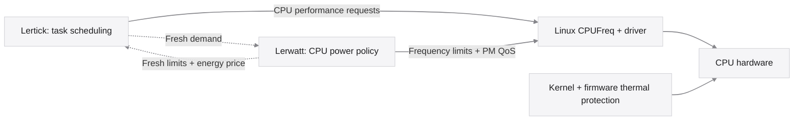

# Lertick + Lerwatt

[← Project home](../README.md) · [Lertick](https://github.com/Denny-Lin/lertick) · [Lerwatt](https://github.com/Denny-Lin/lerwatt)

Use each controller on its own, or enable an optional local link. **Lertick owns scheduling; Lerwatt owns CPU power constraints.** They exchange demand and limits while keeping their models, training and service lifecycles separate.



## Enable the link

First satisfy each project's native Linux requirements. Lerwatt needs usable CPUFreq controls and temperature inputs. Lertick additionally needs a compatible running sched_ext kernel, BTF and its BPF toolchain. Installing these services does not install or change the kernel. A compatible running kernel needs no reboot for activation; changing kernels can require one.

From the **Lerwatt checkout**, as your normal user:

```sh
./deploy.sh check
./deploy.sh install --lertick --period-ms 100
lerwatt status
```

This builds the BPF-capable daemon locally, then installs, enables and starts Lerwatt. Usable Linux userspace BPF headers are required; Lerwatt's contract uses raw BPF syscalls without libbpf. Its service configuration stores `contract=auto`. Coordination accepts a **10–100 ms** control period; the default is 100 ms. A normal independent installation keeps `contract=off` and the BPF-free build.

From the **Lertick checkout**, as your normal user:

```sh
./deploy.sh install
lertick integration on
lertick enable
lertick status
```

Lertick installation adds files without starting or enabling its service. `integration on` saves the optional link setting; `enable` starts now and at boot. Changing integration on an already running managed Lertick service restarts that service with verified settings, preserving its prior active/enabled intent. It does not restart Lerwatt.

**Either project may start first.** An absent or incompatible peer leaves the other operating independently. Neither unit requires the peer through `Requires=` or `BindsTo=`, and neither project starts, stops, upgrades or restarts the peer.

## Check or turn off coordination

```sh
lerwatt status
lerwatt logs
lertick integration status
lertick status
sudo systemctl show lerwatt.service lertick.service --property=StatusText
```

Configured `auto`/`on` means the link is requested. Inspect current worker status and logs for **connected**, **waiting** or **off**; an enabled service or saved setting alone does not prove a fresh compatible exchange. Waiting can mean the peer has not started, its records expired, or its ABI/topology/session is incompatible. Do not interpret a counter from an older run as proof of a current connection.

To keep both controllers but remove their optional link, run this from the Lerwatt checkout:

```sh
./deploy.sh install --no-lertick
```

Then:

```sh
lertick integration off
```

Plain Lerwatt reinstallation and Lertick updates preserve their saved integration settings. Lerwatt stores its setting in `/etc/lerwatt/lerwatt.conf`; Lertick uses `/etc/lertick/integration.conf`. Both are private root-owned data files, parsed without sourcing shell code. Turning off coordination does not disable either controller's own learning.

## Control ownership

| Decision or mechanism | Owner | Boundary |
| --- | --- | --- |
| CPU selection, dispatch, task slices and fairness accounting | Lertick | Kernel sched_ext still provides its registration and fallback mechanism. |
| Per-CPU performance requests | Lertick | Compatible schedutil/CPUFreq operation processes these requests; they are not measured frequency or a physical watt cap. |
| CPUFreq minimum/maximum constraints and available per-CPU PM QoS latency constraints | Lerwatt | Lerwatt keeps its own restore journal and controller lock. |
| Thermal-model fitting and predictive CPU ceiling policy | Lerwatt | Rule fallback and the raw-temperature guard remain independent of the scheduler link. |
| Frequency transitions, idle entry, driver sequencing and thermal trips | Linux drivers, kernel and firmware | Neither project replaces these protection or execution mechanisms. |
| Model weights, learning labels, checkpoints and model selection | Each project separately | No shared weights, joint optimizer or automatic joint retraining. |

Lerwatt currently uses only fresh `lat_crit_milli` from the demand record. The utilization, CPUperf and wake-latency fields support inspection and future policies; they do not establish an enforced application P99 target. Lertick can apply Lerwatt's limits and bounded energy-price adjustment to its performance requests. Task placement is not learned from this price.

These ownership rules describe the two projects. They do not arbitrate every privileged third-party writer. Lerwatt reports known competing power services before startup; another program can still change shared CPUFreq or PM QoS controls later. The contract is **advisory coordination, never a thermal safety interlock**.

## A stable protocol for independent updates

**An algorithm release is not a protocol revision.** A new predictor, thermal model or scheduling policy can retain the same contract and work with the existing peer. Model-only updates must not bump the ABI or require peer retraining. Each project validates, saves or refreshes its own learning state according to its own model format.

| Lertick ABI | Lerwatt ABI | Result |
| --- | --- | --- |
| 2 | 2, with matching topology and a fresh session | Optional coordination is eligible; fresh records are still required. |
| 1 | 2 | Handoff disabled; operate independently and report compatibility/waiting state. |
| 2 | 1 | Handoff disabled; operate independently. Upgrade the older peer to restore coordination. |
| Any | Missing, expired or incompatible peer | Operate independently. |

Update either project first. For a model-only release that keeps ABI 2, verify the new version's own readiness and the link's current status; the peer need not be updated or retrained. If a deliberate schema or field-meaning change introduces a new ABI, document the migration and compatibility matrix, expect independent operation during a mixed-version window, then update the other peer and recheck the link. Never label an incompatible pair connected.

Maintainers must preserve the shared header and golden binary-layout/topology-hash checks for compatible updates. Changing field layout, units or meaning requires an explicit ABI revision and migration tests. Model improvements still need workload and closed-loop evaluation; successful communication does not prove better scheduling or energy use.

## Contract ABI 2

Lertick owns two `BPF_MAP_TYPE_ARRAY` maps with `BPF_F_MMAPABLE`, pinned under `/sys/fs/bpf/lertick/` while its integration-enabled attachment runs. The directory is private. The link uses at most **eight CPUFreq policies**, sorted by their first CPU; larger systems remain independently controlled instead of silently mapping extra policies.

| Record | Single writer | Reader | Fixed size |
| --- | --- | --- | --- |
| `lw_contract` | Lerwatt | Lertick's BPF callbacks | 48 bytes |
| `lt_demand` | Lertick's userspace loader | Lerwatt | 64 bytes |

Both record types carry `version=2`, a sequence counter, `topology_id` and `session_id`. Capacity values use **0–1024**, where 1024 is the fastest CPU performance scale. A zero `ceiling_cap` means no contract cap. Energy price and latency-critical share use **0–1000**. Temperatures/headroom use millidegrees Celsius; timestamps are nanoseconds on **`CLOCK_MONOTONIC`**, not wall-clock time.

`topology_id` hashes the full sorted `related_cpus` set for the policy, followed by the CPU count. ABI 2 specifies FNV-1a with its `LWTOP2` domain and four little-endian bytes per CPU/count. It includes the full policy set, including simulated CPUs not present in a guest. This detects topology disagreement; it is not authentication. Lertick creates a fresh nonzero random `session_id` for each attachment. Lerwatt echoes that generation only after a compatible fresh demand record, so a previous attachment's limits do not authorize a new one.

| Timing rule | Value |
| --- | --- |
| Lertick demand publication target | Every 100 ms |
| Maximum accepted demand age | 500 ms |
| Lerwatt constraint lifetime | 300 ms |
| Retry interval when maps are absent | 1 second |
| Silent attachment age before dropping old maps | 2 seconds |

These are monotonic freshness limits, not realtime scheduling guarantees. The service loop requires 10–100 ms when coordination is enabled so its normal cadence fits the constraint lifetime. Missing, stale, malformed, differently identified or incompatible records provide no handoff. Lerwatt keeps its own local CPU control; Lertick keeps its own scheduler policy when no valid contract applies.

A writer marks the sequence odd during publication and even afterward. Readers use bounded consistency checks and can skip an update; the BPF path does not spin waiting for userspace. Records remain advisory, with field validation and bounded effects. This is not an atomic transaction across policies, a globally synchronized snapshot or proof of closed-loop stability.

## Failure and validation boundaries

Lertick exit/fallback removes its attachment and owned pins; Lerwatt can drop stale maps and retry a later attachment. Lerwatt failure invokes its own watchdog/restore/restart path; its contract limits expire independently. Lertick's `Restart=no` fallback policy is unchanged. Neither project's failure triggers a restart of the peer. Contract expiry does not undo Lerwatt's persistent sysfs settings; Lerwatt's journal recovery handles those separately.

Kernel thermal mitigation and hardware protection remain enabled throughout. Independent fallback means the link stops influencing the peer; it does not promise a fail-closed thermal cap. Supported CPU/sensor layouts, kernel compatibility, other writers and application performance still need their own validation.

Continuous 24-hour and seven-day physical-hardware reliability, physical energy savings and performance advantages are not established by this guide. Record exact software versions, hardware/kernel, duration, fresh-link observations and failure/recovery outcomes when contributing integration evidence.

## Keep independent updates compatible

Both repositories run a frozen **56-value ABI 2 guard** as part of `make test-deployment`. It compiles the public header alone and checks every field offset, record size, timing/scale constants, topology vectors and constraint-validation boundaries. It does not import a model or compare application release versions. A model-only change must preserve these values and the documented control ownership. Its inference/training work must also fit the publication cadence; expired advice always becomes absent advice.

Run the guard by itself, or compare two candidate checkouts before deployment:

```sh
make test-integration-abi
python3 tests/check_integration_abi.py --peer /path/to/other/repository
```

The [recorded ABI 2 validation](../results/integration-abi2/README.md) includes real sched_ext/BPF and systemd tests on Ubuntu 24.04.5 ARM64, kernel 7.0.0-38-generic. Changing Lertick's policy kept Lerwatt's process running; changing Lerwatt's point predictor kept Lertick's process/session running. Both re-established the same interface. These checks demonstrate method-selection compatibility and lifecycle behavior, not a prediction or performance improvement.
